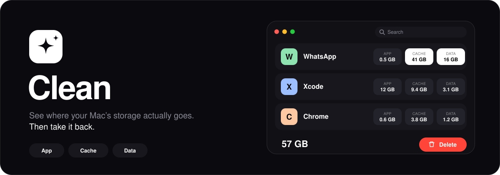
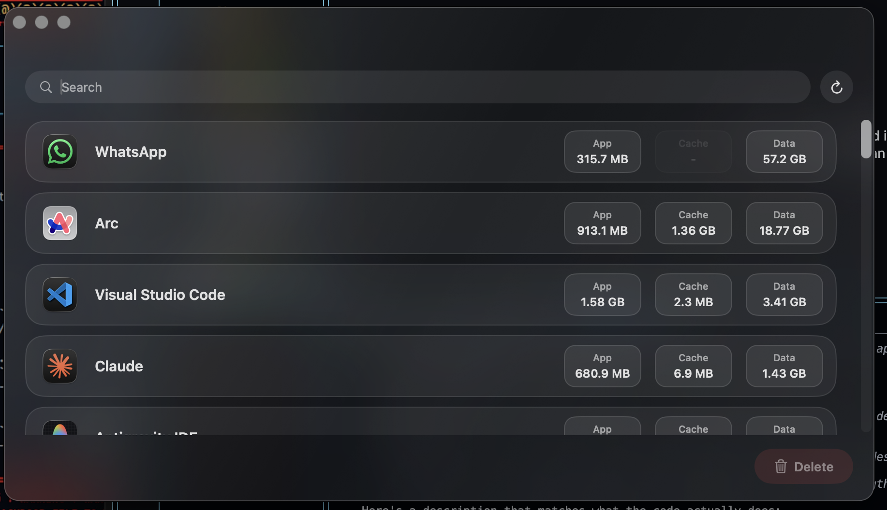

<div align="center">
  
</div>

<br>

**Clean** shows what every app on your Mac really costs you, and lets you trash any part of it in one click.

Your Mac settings only show the size of the app. Clean also finds the hidden part.

**App** is the application itself.
**Cache** is caches and logs that apps can rebuild.
**Data** is leftover data and settings.

Select what you want to remove. Everything goes to the Trash, so you can always put it back.

<br>

<div align="center">
  
</div>

## Install

```bash
git clone https://github.com/roshandhiman/Clean.git
cd Clean
open dist/Clean-1.0.dmg
```

Drag **Clean** into **Applications**.

The first time, macOS will block it because the app isn't notarized. Right-click **Clean**, choose **Open**, then **Open** again.

## Build

```bash
git clone https://github.com/roshandhiman/Clean.git
cd Clean
open Clean.xcodeproj
```

Press **⌘R**. Needs macOS 26.4+ and Xcode 26+.

## Safe

No admin password. No background agents. No network. No telemetry.
Deletes go to the Trash, and Apple system apps are never touched.

<br>

<p align="center">
  Built by <a href="https://github.com/roshandhiman"><b>Roshanpreet Singh Dhiman</b></a>
</p>